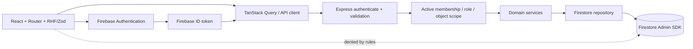
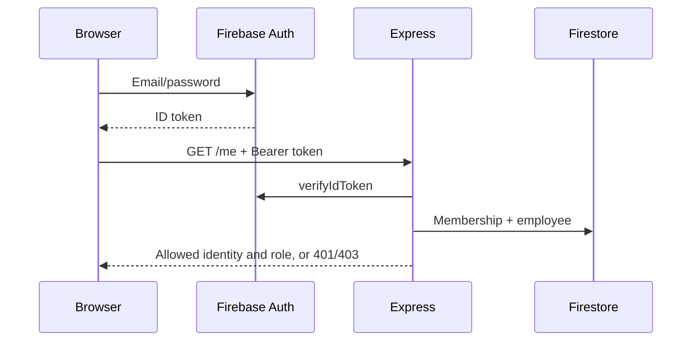
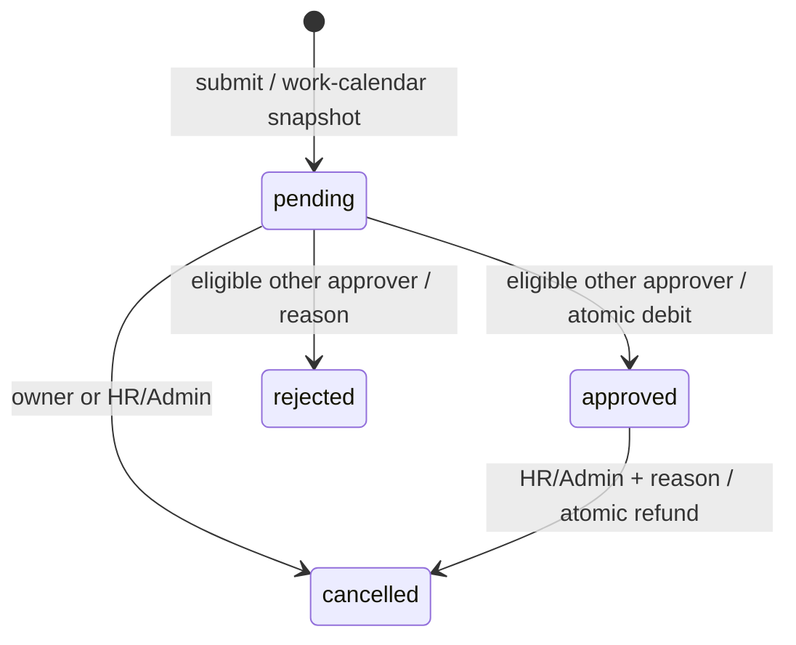

# Architecture

HooSoo is a bounded single-organization demonstration. Its organization is server-selected (`hoosoo`), never accepted from browser input. There is no multi-tenant promise. The test process uses a separate `hoosoo-tests` organization.

The [backend source map](../../backend/README.md) lists route locations and module responsibilities. HTTP routes and domain operations are grouped in `src/modules/`; the Firestore repository implementation lives in `src/database/`.



Authentication tokens are verified, not merely decoded. The API re-reads active membership and current employee/team relationships for each request. Login alone is insufficient; a Firebase account without an active linked membership is denied. Disabling access takes effect on the next API request even with an already issued token. There is no custom authentication backend. Firebase web SDK is used only for Auth in application source.

Routes validate path/query/body, then invoke policies and services. Repositories are the only business-storage access layer. UI routes are guarded for UX, while server policies remain authoritative. The API client obtains the current Firebase token, uses a 20-second timeout and cancellation, distinguishes server/auth/network errors and does not log users out on transient failure. Query keys are cleared when identity changes. Mutations invalidate active data; failures preserve forms. Request receipts reuse a key when a failed submission is retried with identical content. Write requests are never automatically retried by TanStack Query.

## Concurrency and bounds

For this 25-person demo, the repository reads a bounded organization snapshot in a Firestore transaction, including an organization coordination document. Every mutation touches that document, so concurrent commands serialize. Services validate against the state within that transaction. This protects employee-code uniqueness, manager cycles, last Admin, leave overlap, balance debit/refund, audit and request receipts together. Firestore retries re-run only deterministic state operations; Auth provisioning is kept outside the transaction. IDs generated inside retries may differ, but only the final successful attempt is committed.

This conservative design favors correctness for a small demo over throughput. Read requests also load bounded collections and apply scope **before** filtering/paging/DTO serialization. Clients never receive the whole private catalog for search. Caps fail explicitly instead of silently truncating. This is not an architecture for large HR datasets: migrate to indexed per-resource queries, per-employee balance locks/transactions and receipt retention before scaling. All current queries are single-collection bounded scans, so no composite index is required; the committed index file is intentionally empty.

## Login



## Attendance

```mermaid
sequenceDiagram
  participant Browser
  participant API
  participant DB as Firestore transaction
  Browser->>API: POST check-in + idempotency key (no client time)
  API->>DB: Current membership + organization lock
  API->>API: Asia/Ho_Chi_Minh date; employee/date ID
  API->>DB: Insert once + calendar snapshot + audit + receipt
  DB-->>API: Commit
  API-->>Browser: Confirmed record
```

One daytime shift, no overnight calculation. Presence is check-out minus check-in. Paid/demo attendance minutes are the overlap with configured shift minus only the overlapping break. Non-working days and configured holidays have zero paid/demo minutes for complete records. Missing check-out yields null duration, never fabricated zero hours or automatic checkout. Date and transition times originate at the backend. Web check-in does not establish physical location.

## Leave



Pending requests are visible but do not reserve balance. Available = allowance - approved/committed days, including future approved days in the requested year. Overlapping pending/approved date ranges are rejected. The API rechecks available balance at approval. Year boundaries require separate requests. No actor may approve/reject their own request, including Admin/HR. A request with no other eligible active approver is rejected at creation with a clear configuration error. Cancellation of an approved request credits once. Snapshotted working dates/type deduction protect historical math from later policy edits.

## Account provisioning

A durable job reserves a deterministic UID for the employee, then the API creates the Auth account, then a second transaction links employee, membership, job completion and audit. No password is stored in Firestore or logged. A failed link leaves an explicit pending/failed job visible to Admin. Retrying the same employee recovers the same UID and verifies the email; it does not reset an existing password. A pending job has a 60-second recovery delay. Concurrent reservations return 409. Permanent email conflicts require another employee email before linkage. This is a recoverable saga, not a cross-service atomic transaction. Monitoring pending/failed jobs is necessary in a deployment.
